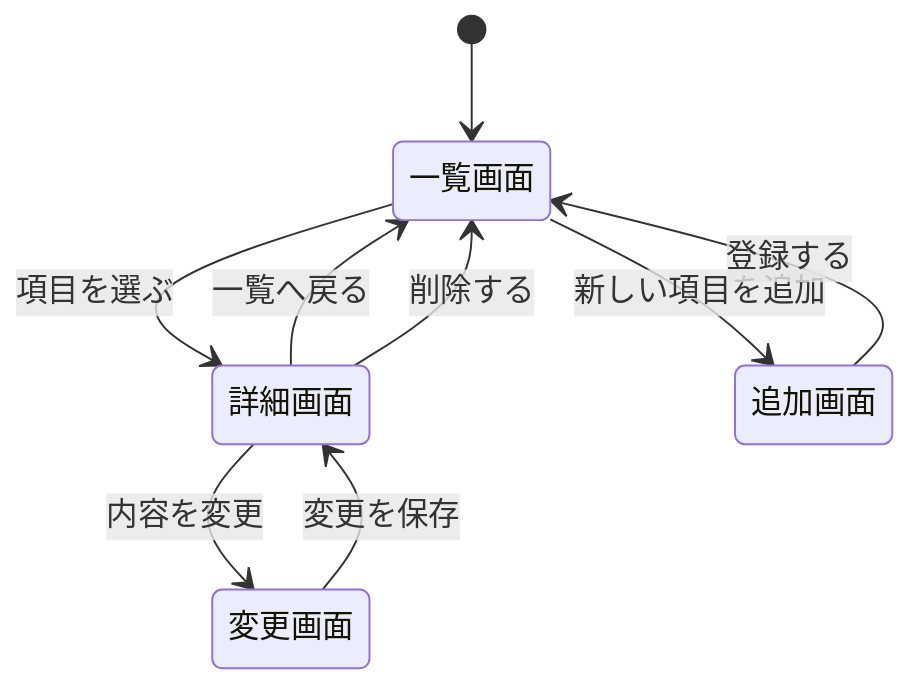

# レポート用Webアプリの設計案

## 共通方針

京葉線の例とは別に、次の3つの一覧表示を中心としたアプリを作る。対象と項目は今後の授業内容に応じて変更できる案とする。

1. 読みたい本の管理
2. 見たい映画の管理
3. 作りたい料理の管理

データはそれぞれサーバ内の配列に保持する。再起動すると初期データに戻る。各アプリで一覧・詳細・追加・変更・削除を扱う。REST APIの具体的な設計は、今後の授業での説明を踏まえて決める。JavaScriptファイルの先頭には `"use strict";` を付ける。

## 画面の流れ

3つのアプリに共通する画面遷移の案は次のとおり。

## 1. 読みたい本の管理

読みたい本を登録し、タイトルと著者の一覧から詳細を確認する。前回作成した本の一覧・追加機能を出発点とし、詳細表示や変更・削除を加えることを想定する。

| 項目名 | 型 | 内容 |
| --- | --- | --- |
| id | 数値 | 本を区別するID |
| title | 文字列 | 本のタイトル |
| author | 文字列 | 著者名 |
| genre | 文字列 | ジャンル |
| status | 文字列 | 未読・読書中・読了などの状態 |

## 2. 見たい映画の管理

見たい映画を登録し、タイトルの一覧から作品情報を確認する。

| 項目名 | 型 | 内容 |
| --- | --- | --- |
| id | 数値 | 映画を区別するID |
| title | 文字列 | 映画のタイトル |
| director | 文字列 | 監督名 |
| year | 数値 | 公開年 |
| status | 文字列 | 見たい・鑑賞済みなどの状態 |

## 3. 作りたい料理の管理

作りたい料理を登録し、一覧から材料や調理の目安を確認する。

| 項目名 | 型 | 内容 |
| --- | --- | --- |
| id | 数値 | 料理を区別するID |
| name | 文字列 | 料理名 |
| ingredients | 文字列 | 主な材料 |
| minutes | 数値 | 調理時間の目安（分） |
| note | 文字列 | 調理のメモ |

## 仕様書について

完成する仕様書は利用者向け・管理者向け・開発者向けの3部構成とする。ソースコードのGitHub URLを記載し、授業で説明されていない技術を採用する場合は、その概要と採用理由を記載する。その他の項目は今後の指示に従って追加する。

現在の作業リポジトリ： https://github.com/togo08/webpro_06
