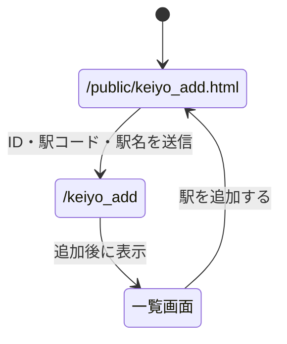

# 第8回 データの表示と追加

## 起動方法

```sh
node app5.js
```

- 駅の一覧： http://localhost:8080/keiyo
- 駅の登録： http://localhost:8080/public/keiyo_add.html
- 本の一覧： http://localhost:8080/books
- 本の登録： http://localhost:8080/public/books_add.html

`views/db1.ejs` は講義資料の列挙形式、`views/db2.ejs` は表形式の例です。`/keiyo` では表形式を表示します。

## 登録後の画面

入力画面へリダイレクトすると続けて入力できます。一覧画面を表示すると、追加された内容をすぐに確認できます。今回は、登録結果を確認でき、一覧から入力画面に戻ることもできるため、一覧画面を表示する方法を選びました。



本の登録も同様に、入力画面からデータを送信し、追加後に一覧を表示します。講義の例に合わせ、データはサーバの配列に保存しているため、サーバを再起動すると追加したデータは消えます。
